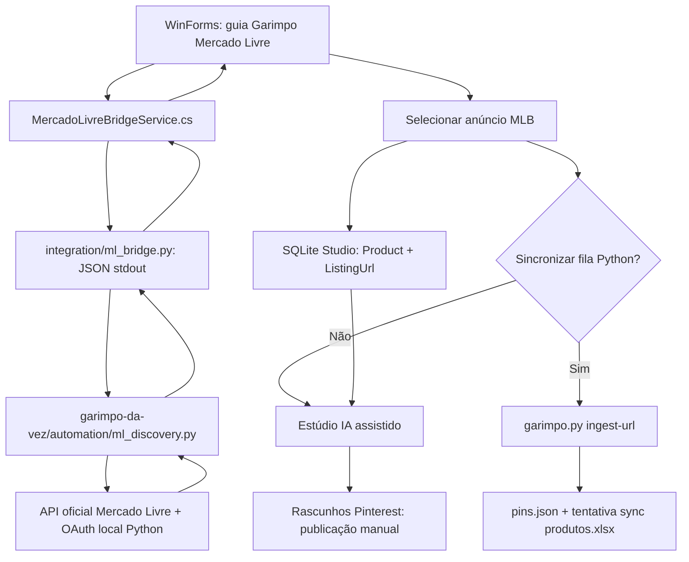

# Arquitetura — Garimpo da Vez Studio

## Fluxo funcional

## Interfaces e responsabilidades

- `Services/MercadoLivreBridgeService.cs`: valida pasta raiz do motor Python, seleciona venv quando existe, inicia subprocessos **sem shell**, define limite de 65 segundos, recebe JSON estruturado. Nunca imprime tokens. Configuração de caminho em arquivo local.
- `integration/ml_bridge.py`: **não** implementa cliente alternativo da API. Importa `root_categories`, `children_of`, `search_listings` e `read_token` de `automation/ml_discovery.py`. Para sincronizar fila utiliza `garimpo.py ingest-url`, preservando validações e atualização automática do Excel quando permitido.
- `UI/MainForm.cs`: carrega categorias/subcategorias, pesquisas e resultados; importa seleção com prevenção de duplicidade por `Source + ExternalId`. Mostra status e erros de acesso e oferece abertura do permalink oficial.
- `Data/StudioRepository.cs`: SQLite privado com `listing_url` separado do `affiliate_url`. Em bancos antigos adiciona `listing_url` com `ALTER TABLE`, preservando registros existentes. IDs locais continuam UUID.
- `ExcelExportService`: gera um arquivo XLSX próprio do Studio. **Não** compartilha automaticamente um mesmo arquivo aberto com o Python para evitar conflitos de gravação.

## Restrições / invariantes

1. `MLB...` corresponde a um ID **de anúncio**; não confundir com ID de categoria ou produto de catálogo.
2. Permalink comum não é link de afiliado. A importação deixa `AffiliateUrl` vazio, e não concede elegibilidade a comissão.
3. Se API retornar 401/403, mostrar falha: sem scraping/contorno nem fallback fictício.
4. A busca não altera a fila Python; somente a seleção com sincronização marcada solicita `ingest-url`. Uma falha posterior mantém o registro local e mostra alerta.
5. Reimportação de `Source + ExternalId` não sobrepõe título, descrição, imagem, link de afiliado nem status já editados no Studio.
6. Tokens OAuth e segredos são mantidos pelo módulo Python original, não copiados para SQLite, XLSX ou repositório.
7. Edição de imagem com ChatGPT e postagem de Pin continuam assistidas/manuais.

## Requisitos do sistema

Windows + .NET 10, Python 3.11+, duas pastas de repositório disponíveis. O executável precisa empacotar `integration/ml_bridge.py`, incluído como Content em `.csproj`. O Python original não é incluído e deve ser configurado no computador do usuário.
