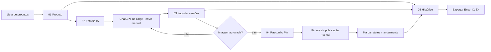
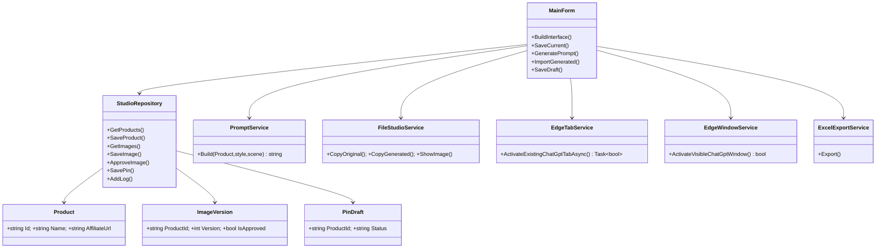

# Mapa de telas e arquitetura — Garimpo da Vez Studio — MVP

## Navegação

## Estrutura de classes

## SQLite

Tabelas: `products`, `image_versions`, `pin_drafts`, `studio_logs`.
Chaves estrangeiras habilitadas com `PRAGMA foreign_keys=ON`, comandos parametrizados,
versões únicas por produto, e no máximo uma versão aprovada por operação lógica.
Arquivo do banco: `%LOCALAPPDATA%\GarimpoDaVezStudio\studio.sqlite`.

## Integração planejada com garimpo.py (não implementada no MVP)

Adicionar uma fronteira `IProductProvider`, com `SearchAsync(query, category, niche)` e
`ImportAsync(selectedProduct)`. O adaptador Python deve produzir JSON com título,
identificador externo, categoria, descrição e caminho de foto; **não presumir** que
os parâmetros do CLI atual já atendem a esse contrato. Vincular produto à fonte
por `Source` + `ExternalId` para evitar duplicados. Não gerar links de afiliado a
partir de IDs simples sem mecanismo oficialmente disponibilizado.

## Decisões de limites

- Nenhuma API paga de imagens.
- O aplicativo **não** automatiza o envio no ChatGPT, o download de respostas ou a publicação no Pinterest.
- Apenas traz ao primeiro plano uma aba existente: via CDP se configurado ou via
  título de janela do Edge se o ChatGPT estiver na guia ativa.
- Os status de publicação são declarações manuais, sem validação remota.
- Não há analytics de Pinterest, monetização nem descoberta automática de produtos neste MVP.
